# eslee Download Router

Current version: **v2.0.0** — [changes, verification and limitations](.github/release-notes/v2.0.0.md).

A Windows app that moves files you download in your browser into the folder you set for each site. You can also have it ask which folder to use every time.

[⬇️ **Download the latest version**](https://github.com/esleeeeee/eslee-download-router/releases/latest)

**Language:** [한국어](README.md) · English

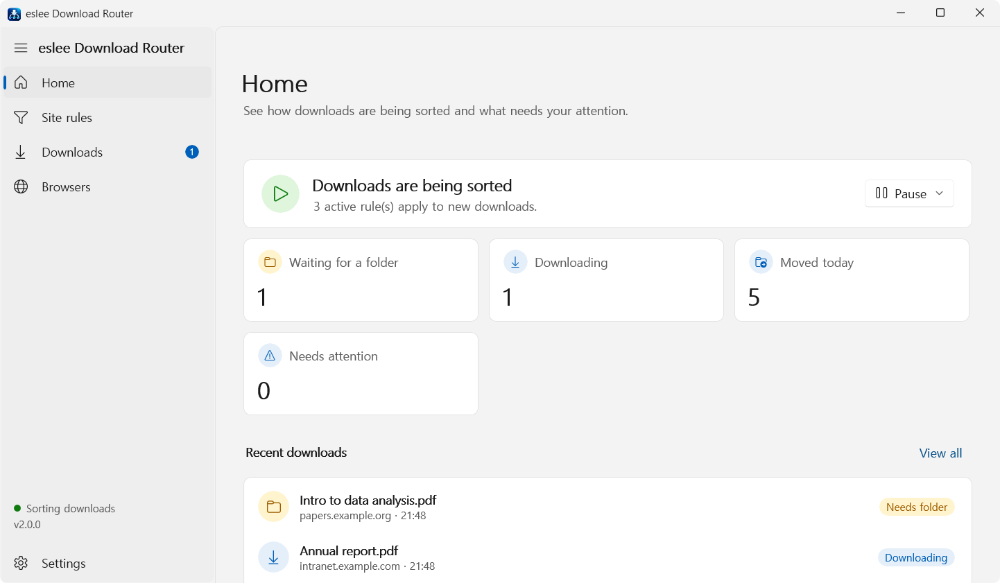

## About

The app saves you from opening the Downloads folder and moving files one by one.

- You create **site rules** such as "files from the company file library go to `D:\Files\Company`" or "PDFs from the papers site ask for a folder each time".
- The browser extension reports each download, and the app moves only the files that match a rule.
- Downloads that match no rule are left alone and saved by the browser as usual.

> **Note:** If the app or the extension has a problem, your browser downloads are never blocked. Sorting is simply skipped and the file stays where the browser saved it.

## Features

- Per-site **automatic moves**, or **choose a folder** for each download
- **File type conditions** per rule (for example, PDF only, or everything except ZIP)
- **Favorite and recent folders** and **Use for 10 minutes** in the folder window
- **Pause sorting** (30 minutes, 1 hour, 3 hours, or until you resume)
- **Open file, Show in folder and Retry** from the download history
- Rules whose base folder is missing are marked **Needs attention**
- **Rule export/import**, **automatic history cleanup**, **move notifications**
- Light/dark theme, Korean/English

## 1. Install

1. On the [latest release page](https://github.com/esleeeeee/eslee-download-router/releases/latest), download **`eslee-download-router-setup.exe`**.
   - `Source code (zip)` and `Source code (tar.gz)` are source archives; you do not need them.
2. Run the downloaded file. No administrator rights are needed; the app is installed for your Windows account only.
3. If **Windows protected your PC** appears, choose **More info** → **Run anyway**.
   The warning appears because the installer is not code-signed. Make sure you downloaded it from the official page above.
4. Follow the setup wizard. Choose these options if you like (you can change them later in Settings):
   - **Start in the background when I sign in to Windows** — on by default. Keep it on so downloads are sorted every time you start your PC.
   - **Create a desktop shortcut**

The installer also registers the connection between the browser extension and the app.

> Requirements: Windows 11 (64-bit). NAVER Whale, Microsoft Edge and Google Chrome are officially supported; Brave, Vivaldi and Opera are compatible. Firefox is not supported.

## 2. First run: connect the browser extension

For the app to notice downloads, you add an extension to your browser **once**. It is not in the browser stores yet, so you load it yourself.

The first time you open the app after installing, it opens on the **Browsers** page.

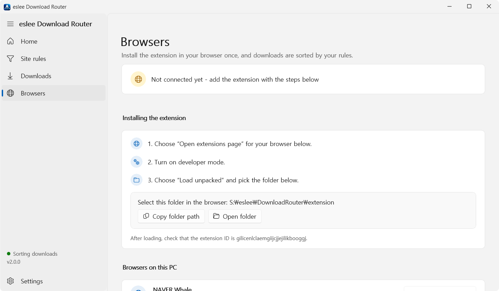

1. In **Browsers on this PC** at the bottom, choose **Open extensions page** for your browser.
   To open it yourself, type `whale://extensions` (Whale), `edge://extensions` (Edge) or `chrome://extensions` (Chrome) in the address bar.
2. Turn on **Developer mode** on the extensions page.
3. Choose **Load unpacked** and pick the folder shown in the app.
   **Copy folder path** lets you paste it into the folder dialog's address box.
4. Check that the extension ID is `gilicenlclaemgiijcjjejilikbooggj`.

Until the extension is connected, Home shows a reminder too. **Show how to connect** takes you to the page above.

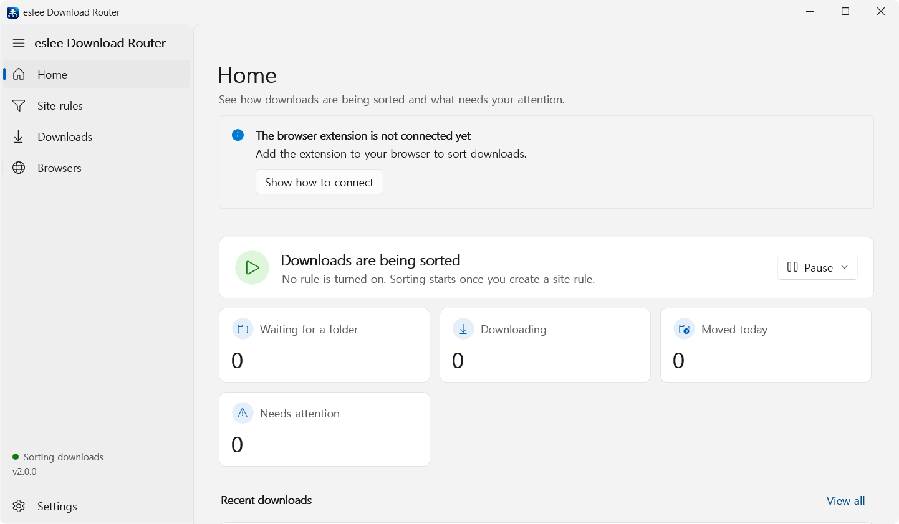

After connecting, download any file in the browser and the top of the Browsers page changes to **Connected · last contact (time)**.

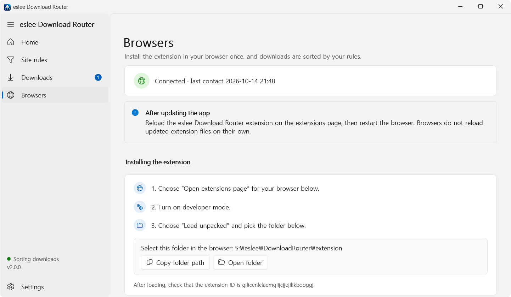

> On work or school PCs, a security policy may block developer mode or loading extensions.

## 3. Create a site rule

A rule decides which folder receives files downloaded from which site.

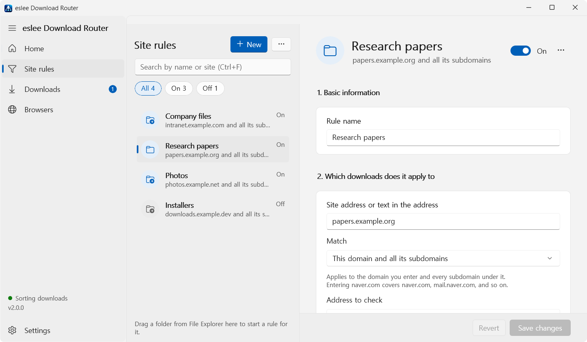

1. Open **Site rules** on the left and choose **New**.
   You can also drag a folder from File Explorer onto this page to start a rule that saves into it.
2. **1. Basic information** — give the rule a name you will recognize (for example, `Research papers`).
3. **2. Which downloads does it apply to** — enter the site address (for example, `papers.example.org`) and choose a **Match** option.
   For **Address to check**, the default **The page that started the download** is right in most cases.
4. **3. Which files does it apply to** — set file types if needed (see below).
5. **4. Where should files go** — choose the **Base folder** with **Browse…** and pick **How to save**.
6. Check **5. Summary**, then choose **Save rule** at the bottom.

The **On** switch at the top right turns a rule off for a while. Deleting a rule never deletes files already moved or their history.

### How to save

| What you want | Choose |
|---|---|
| Always send files to the same folder | **Move to a set folder automatically** |
| Pick a subfolder inside the base folder for each download | **Choose a subfolder for each download** |

- If a file with the same name exists, the app **never overwrites it** and saves the new file as `file (1).pdf`.
- When moving to another drive, the app checks the copy before removing the original. If the check fails, the original stays.

### File type conditions

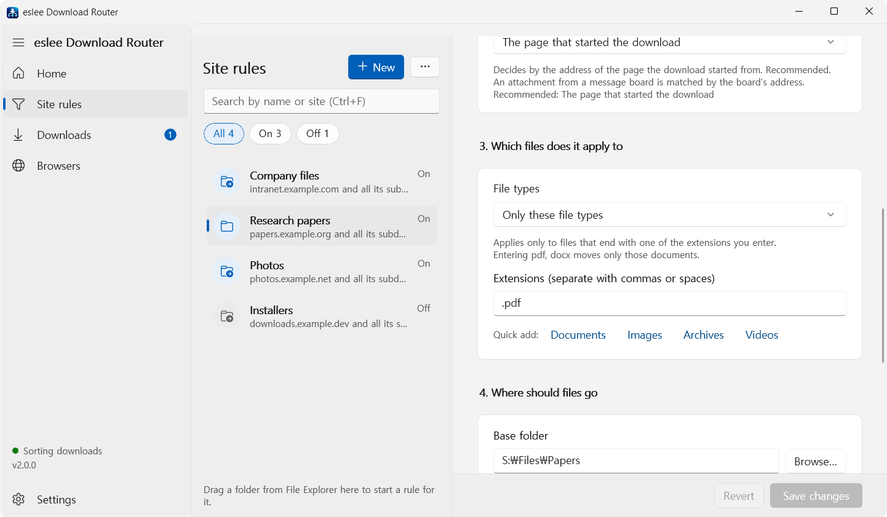

Under **File types**, choose one of:

- **All files** — applies to every extension (default).
- **Only these file types** — for example, only `.pdf` files use this rule.
- **All except these file types** — for example, `.zip` files are not moved.

Separate extensions with commas or spaces, or use **Quick add** (**Documents, Images, Archives, Videos**).

### Back up and move rules

Use **Export rules…** in the **⋯** menu next to **New** to save your rules as a JSON file, and **Import rules…** on another PC.

- Imported rules are added **turned off**. Review them, then turn them on yourself.
- Rules you already have are skipped, and rules with network paths (`\\server\...`) are not imported.

## 4. Choose where to save

When a rule uses **Choose a subfolder for each download**, this window opens when the download starts.

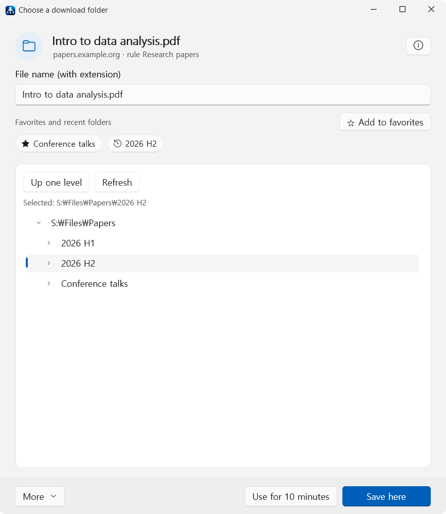

1. Edit **File name (with extension)** at the top if needed. Leave it as is to keep the original name.
2. Pick a folder in the list. Only the rule's base folder and the folders inside it can be chosen.
   - **Up one level** moves up; **Refresh** shows a folder you just created.
   - **☆ Add to favorites** keeps the folder under **Favorites and recent folders** with a ★. Recently used folders appear there as well, so you can pick them in one click.
3. **Save here** moves the file into that folder when the download finishes.

Other buttons:

| Button | Result |
|---|---|
| **Use for 10 minutes** | Saves this file and every file from the same rule for the next 10 minutes into this folder. You can **Cancel** it on Home |
| **More > Keep waiting in the list** | Decide later from **Waiting** on the Downloads page |
| **More > Do not move this file** | The file is not moved and stays where the browser saved it |
| **More > Close and keep waiting** | Closes the window and keeps the file waiting. The **X** at the top right does the same |

> The window opens automatically **only once per file**. Handle files you left waiting from the Downloads page.

## 5. Download history

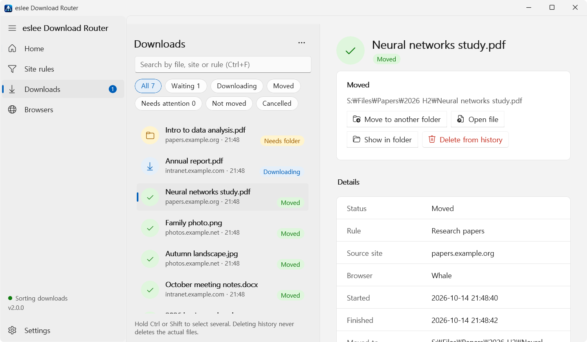

**Downloads** lists only downloads that matched a site rule. The number next to the menu is how many files are waiting for a folder.

- Use the buttons at the top to show **All / Waiting / Downloading / Moved / Needs attention / Not moved / Cancelled**. The search box (`Ctrl+F`) finds file names, sites and rules.
- Select a file to use these on the right:
  - **Open file**, **Show in folder**
  - **Move to another folder** — changes the folder of a file already moved.
  - **Choose folder** — picks the folder for a waiting file.
  - **Retry** — moves a file that could not be moved (Needs attention) again.
  - **Delete from history**
- Hold `Ctrl` or `Shift` to select several and handle them together. Waiting files from the same rule can get one folder at once.

> **Deleting history never deletes the files.** Only the app's records are cleared.

## 6. Pause sorting

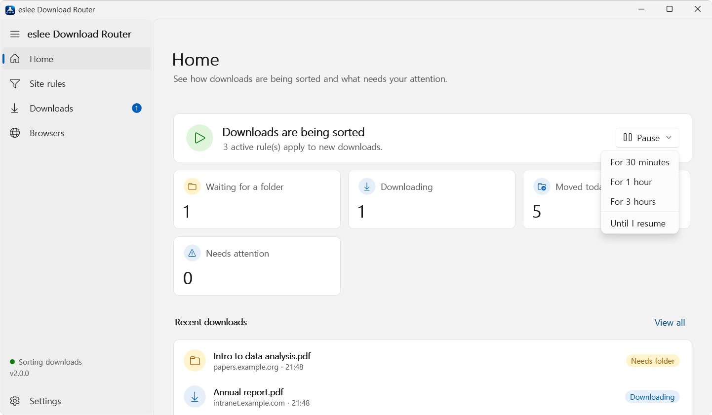

To download without rules for a while, choose **Pause** on Home and pick **For 30 minutes / For 1 hour / For 3 hours / Until I resume**.

- Files downloaded while paused are not moved; the browser saves them as usual.
- Sorting turns back on by itself when the time is up. Choose **Resume** to turn it on right away.
- **Pause sorting for 1 hour** in the tray menu does the same.

## Window layout

| Page | What it shows |
|---|---|
| **Home** | Sorting status; counts of files waiting for a folder, downloading, moved today and needing attention; recent downloads |
| **Site rules** | Rule list and editor. Rules whose base folder is missing are marked **Needs attention** |
| **Downloads** | History of downloads that matched a rule, and what to do with them |
| **Browsers** | Extension connection status, setup steps, browsers installed on this PC |
| **Settings** | Theme, language, behavior, history cleanup, troubleshooting, about |

The bottom left shows whether sorting is on (**Sorting downloads**) and the version.

## Settings

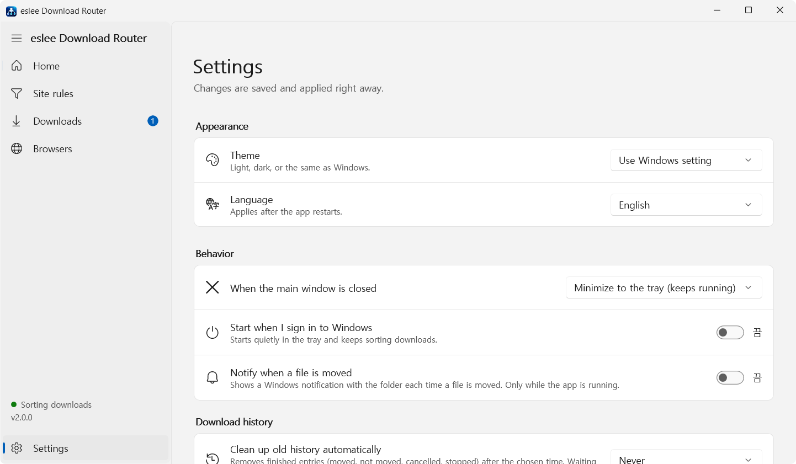

Choose **Settings** at the bottom left. Changes apply right away without a save button.

| Item | Description |
|---|---|
| **Appearance > Theme** | Use Windows setting / Light / Dark |
| **Appearance > Language** | Use Windows setting / 한국어 / English (applies after a restart) |
| **Behavior > When the main window is closed** | Minimize to the tray (keeps running) or close the app window completely |
| **Behavior > Start when I sign in to Windows** | Starts quietly in the tray at sign-in and keeps sorting downloads |
| **Behavior > Notify when a file is moved** | Shows a Windows notification with the folder each time a file is moved (off by default) |
| **Download history > Clean up old history automatically** | Never / older than 7, 30, 90, 180 days or 1 year. Waiting and failed entries, and the files themselves, are never deleted |
| **Troubleshooting** | Check the agent connection, open the data folder, diagnostic details |
| **About** | Version, update check, privacy, supported browsers |

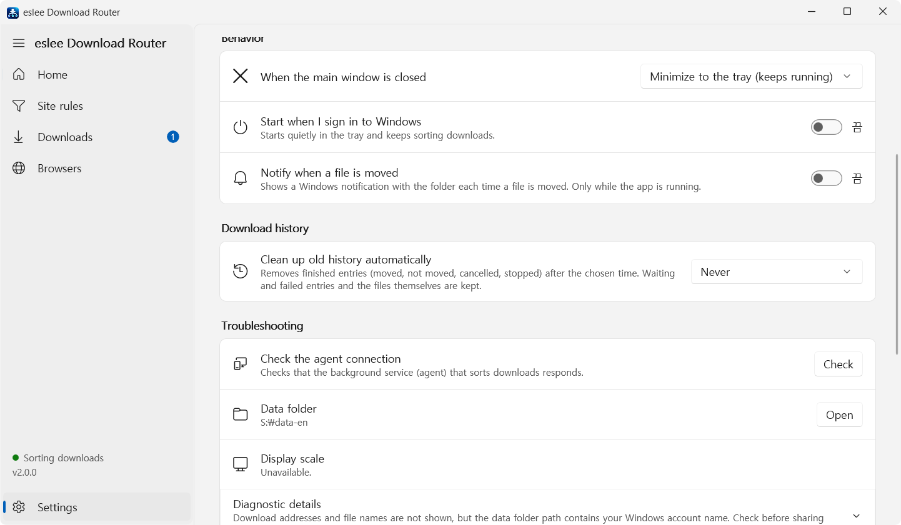

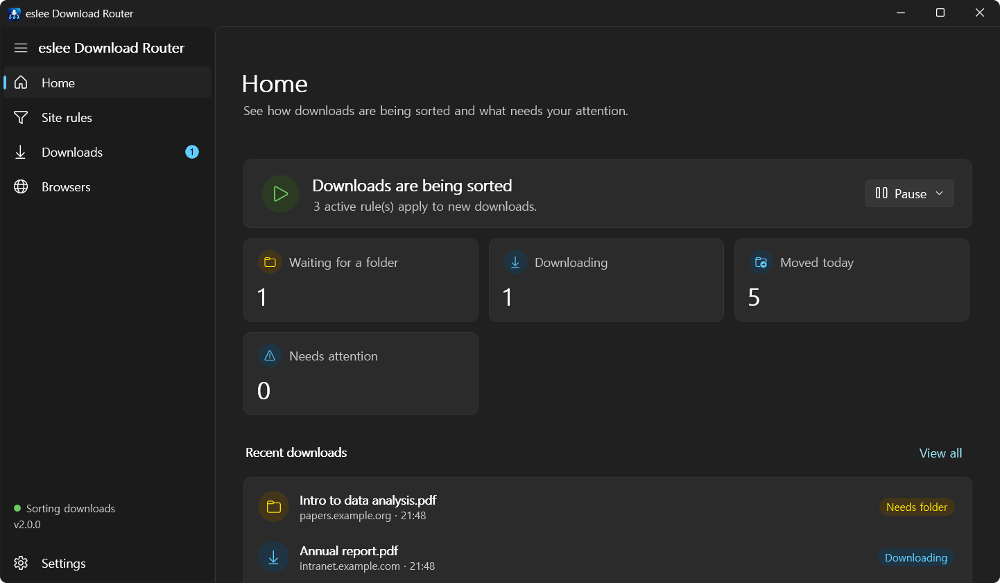

The dark theme.

## System tray

- Choosing **X** hides the app in the notification area (tray) at the right of the taskbar instead of closing it. It keeps sorting downloads while hidden.
- **Double-click** the tray icon to open the window again. A single click does not open it.
- **Right-click** the tray icon for **Open eslee Download Router**, **Open files waiting for a folder**, **Settings**, **Pause sorting for 1 hour** (**Resume sorting** while paused) and **Exit**.
- To close the app completely, choose **Exit** in the tray menu. Files downloaded while it is closed are not sorted.
- If you use eslee Tray Folder, the app appears inside the Tray Folder menu instead of having its own tray icon.

## Troubleshooting

**New downloads are not sorted.**
1. Check for an extension notice at the top of Home.
2. Check that the bottom left says **Sorting downloads**. If sorting is paused, choose **Resume** on Home.
3. In **Site rules**, check that the rule is on and that its site address and file types match.
4. Choose **Settings > Troubleshooting > Check the agent connection**.

Downloads that match no rule are saved where the browser puts them and do not appear in the history. That is expected.

**After updating the app, downloads are not recorded.**
Browsers do not reload changed extension files on their own. On the extensions page, choose **Reload (↻)** for **eslee Download Router**, then close the browser completely and open it again. Browser downloads keep working normally in the meantime.

**A rule says "Needs attention".**
Its base folder is missing, or the external drive it is on is not connected. Create the folder again or connect the drive, or choose another folder with **Browse…** in the rule.

**A file could not be moved (Needs attention).**
Check that the base folder exists and that no other program has the file open, then choose **Retry** on the Downloads page. The original file is still where the browser saved it.

**The folder window does not open.**
Check that the rule uses **Choose a subfolder for each download**. A file whose window you closed, or that you kept waiting, does not ask again; choose its folder from **Downloads > Waiting**.

**The app disappeared when I chose X.**
It is hidden in the tray. Double-click the tray icon. To close the window completely with X, change **Settings > Behavior > When the main window is closed**.

**The extension does not connect.**
Check that the extension ID is `gilicenlclaemgiijcjjejilikbooggj` and that developer mode is on, then restart the browser completely. Browser-specific steps are in the [manual extension install guide](docs/MANUAL_EXTENSION_INSTALL.md).

If this does not help, describe the problem and the steps to reproduce it in [GitHub Issues](https://github.com/esleeeeee/eslee-download-router/issues). Remove file names, paths and other personal details before attaching logs or diagnostic details.

## Updating and uninstalling

- **Update**: run the new installer. Rules, download history and settings are kept. After installing, **reload the extension once** as described above.
- **Settings > About > Updates** shows whether a new version is out (checked automatically once a day). Nothing is installed automatically.
- **Uninstall**: remove the app from the app list in Windows Settings. Startup, browser connection and notification registrations are removed too.
- Rules and history (`%LOCALAPPDATA%\eslee\DownloadRouter`) are kept after uninstalling, so a reinstall continues where you left off. Delete that folder yourself to remove everything. Remove the browser extension from the extensions page.

## Privacy

- No accounts, ads or usage statistics.
- The browser extension and the app talk **only within your PC**. Your full browsing history is not collected; only download information is used.
- The internet is used only to check for new versions. The app reads public release information from GitHub and sends nothing about your PC.
- All data is stored in `%LOCALAPPDATA%\eslee\DownloadRouter`:
  - Rules and download history (file names, save paths, source addresses). Credentials in addresses, the part after `?` and the part after `#` are not stored.
  - Settings (`config.local.json`) and logs. Logs may contain file names, and `app-unhandled.log`, written after an unexpected error, may contain full paths.

See [SECURITY.md](SECURITY.md) for the security design.

## Limitations

- Built for Windows 11 (64-bit) and Chromium-based browsers. Firefox, Safari and mobile browsers are not supported.
- Brave, Vivaldi and Opera are designed to work the same way but have not been verified with real downloads yet.
- The extension is loaded in developer mode, not from a browser store.
- Downloads are sorted only while the app is running.
- The folder window cannot create new folders. Create one in File Explorer, then choose **Refresh**.
- The installer is not code-signed, so SmartScreen may warn on first run.
- See [browser compatibility](docs/BROWSER_COMPATIBILITY.md) and the [release notes](.github/release-notes/v2.0.0.md) for details.

## How it works

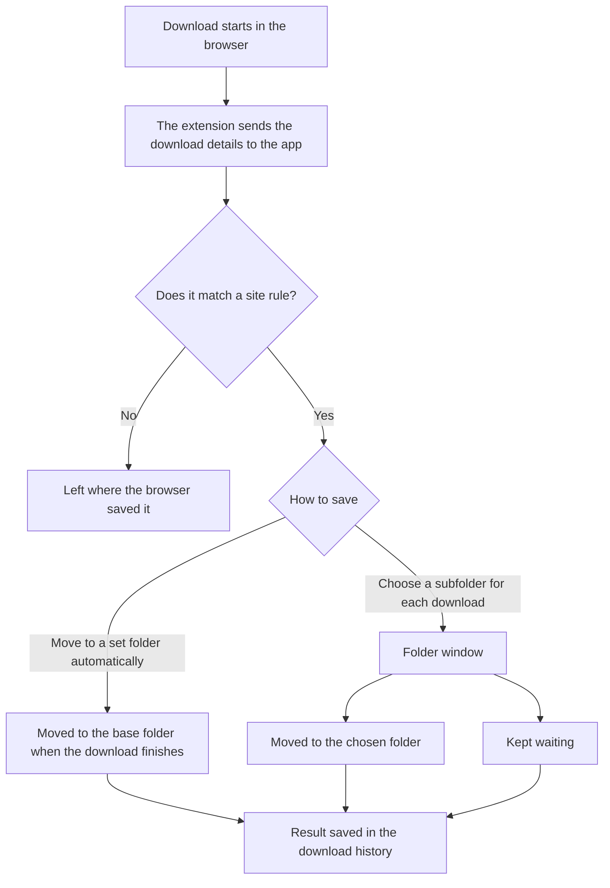

1. The browser extension tells the app when a download starts and finishes (Native Messaging).
2. A background service (the agent) compares it with your site rules and decides whether to move it or ask for a folder.
3. When the download finishes, the file is moved safely and the result is recorded. If any step fails, the file stays where it was.

See [ARCHITECTURE.md](ARCHITECTURE.md) for the internal design.

## For developers

Built with C# / .NET 10, WinUI 3, SQLite, a TypeScript Chromium extension and Inno Setup.

```powershell
git clone https://github.com/esleeeeee/eslee-download-router.git
Set-Location eslee-download-router
powershell -NoProfile -ExecutionPolicy Bypass -File .\scripts\bootstrap.ps1
powershell -NoProfile -ExecutionPolicy Bypass -File .\scripts\build.ps1
powershell -NoProfile -ExecutionPolicy Bypass -File .\scripts\test.ps1
```

- [DEVELOPMENT.md](DEVELOPMENT.md) — environment, build, installer, extension version policy
- [ARCHITECTURE.md](ARCHITECTURE.md) — components, state model, trust boundaries
- [TESTING.md](TESTING.md) — automated tests and manual verification scenarios
- [SECURITY.md](SECURITY.md) — security design and vulnerability reports
- [docs/MANUAL_EXTENSION_INSTALL.md](docs/MANUAL_EXTENSION_INSTALL.md) — per-browser extension install and development registration
- [docs/BROWSER_COMPATIBILITY.md](docs/BROWSER_COMPATIBILITY.md) — verification scope per browser
- [CHANGELOG](CHANGELOG.md) — version history

The whole project was built by vibe coding with AI coding agents. Screenshots use example sites and example folders.

## License

Released under the [MIT License](LICENSE). Anyone may use, modify and distribute it, as long as the copyright notice and license text are included. The software is provided as is, without warranty of any kind.
