# eslee Download Router

현재 버전: **v2.0.0** — [변경·검증·제한](.github/release-notes/v2.0.0.md).

브라우저에서 내려받은 파일을 사이트별로 정해 둔 폴더에 자동으로 옮겨 주는 Windows 프로그램입니다. 받을 때마다 저장할 폴더를 직접 고르게 할 수도 있습니다.

[⬇️ **최신 버전 다운로드**](https://github.com/esleeeeee/eslee-download-router/releases/latest)

**문서 언어:** 한국어 · [English](README.en.md)

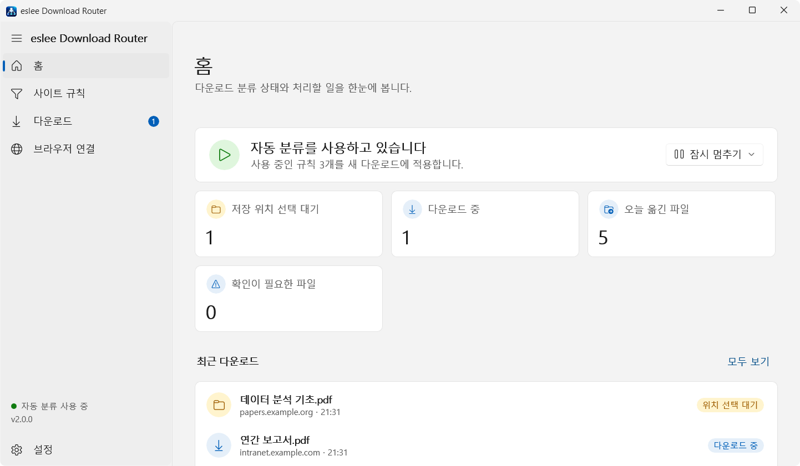

## 소개

다운로드 폴더를 열어 파일을 하나씩 옮기는 일을 대신하는 프로그램입니다.

- 예를 들어 "회사 자료실에서 받은 파일은 `D:\자료\회사`로", "논문 사이트에서 받은 PDF는 받을 때마다 폴더를 고르기"처럼 **사이트 규칙**을 만들어 둡니다.
- 브라우저 확장이 다운로드를 알려 주면, 프로그램이 규칙에 맞는 파일만 옮깁니다.
- 규칙에 맞지 않는 다운로드는 건드리지 않고 브라우저가 평소처럼 저장합니다.

> **참고:** 프로그램이나 확장에 문제가 생겨도 브라우저의 다운로드는 막지 않습니다. 정리만 건너뛰고 파일은 원래 자리에 남습니다.

## 주요 기능

- 사이트별 **자동 이동** 또는 받을 때마다 **저장 폴더 선택**
- 규칙별 **파일 종류 조건** (예: PDF만, ZIP 제외)
- 저장 위치 선택 창의 **즐겨찾기·최근 폴더**와 **10분간 이 위치로**
- **자동 분류 잠시 멈추기** (30분·1시간·3시간·다시 켤 때까지)
- 다운로드 기록에서 **파일 열기·폴더에서 보기·실패한 이동 다시 시도**
- 기준 폴더가 사라진 규칙을 **확인 필요**로 표시
- **규칙 내보내기·가져오기**, **오래된 기록 자동 정리**, **이동 완료 알림**
- 라이트/다크 테마, 한국어/English

## 1. 설치

1. [최신 버전 페이지](https://github.com/esleeeeee/eslee-download-router/releases/latest)에서 **`eslee-download-router-setup.exe`** 를 내려받습니다.
   - `Source code (zip)`, `Source code (tar.gz)`는 소스 코드 묶음이므로 받지 않아도 됩니다.
2. 내려받은 파일을 실행합니다. 관리자 권한은 필요 없고, 지금 쓰는 Windows 계정에만 설치됩니다.
3. **Windows의 PC 보호** 창이 나타나면 **추가 정보** → **실행**을 누릅니다.
   설치 파일에 코드 서명이 없어서 표시되는 경고입니다. 위의 공식 페이지에서 받은 파일인지 먼저 확인하세요.
4. 설치 마법사를 진행합니다. 필요하면 다음 항목을 선택합니다(나중에 설정에서 바꿀 수 있습니다).
   - **Windows 로그인 시 백그라운드로 자동 시작** — 기본으로 켜져 있습니다. 켜 두어야 PC를 켤 때마다 다운로드가 정리됩니다.
   - **바탕 화면 바로가기 만들기**

설치 프로그램이 브라우저 확장과 프로그램을 연결하는 설정도 함께 등록합니다.

> 지원 환경: Windows 11(64비트). 브라우저는 네이버 웨일, Microsoft Edge, Google Chrome을 공식 지원하고 Brave, Vivaldi, Opera는 호환 지원합니다. Firefox는 지원하지 않습니다.

## 2. 처음 실행: 브라우저 확장 연결

프로그램이 다운로드를 알아채려면 브라우저에 확장을 **한 번** 추가해야 합니다. 아직 브라우저 스토어에 올라가 있지 않아 직접 불러옵니다.

설치 후 처음 실행하면 **브라우저 연결** 화면이 열립니다.

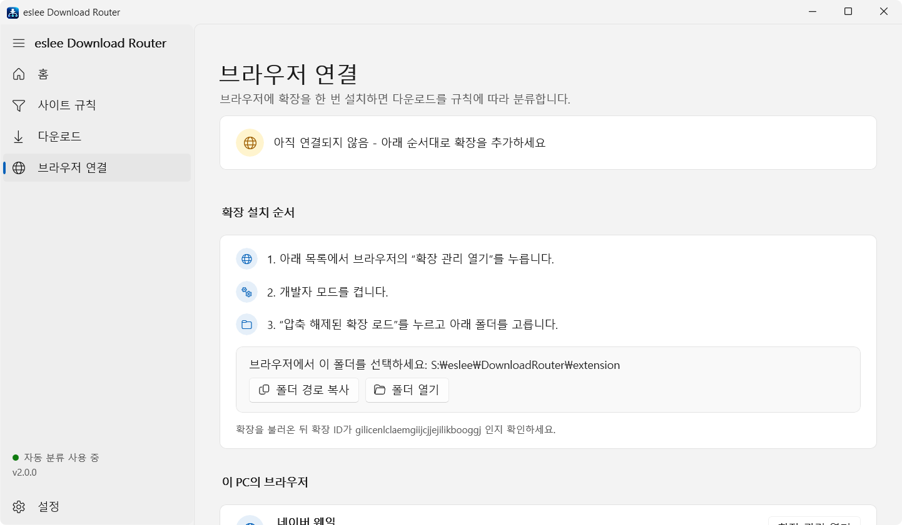

1. 화면 아래 **이 PC의 브라우저** 목록에서 쓰는 브라우저의 **확장 관리 열기**를 누릅니다.
   직접 열려면 주소창에 `whale://extensions`(웨일), `edge://extensions`(Edge), `chrome://extensions`(Chrome)를 입력합니다.
2. 확장 관리 화면에서 **개발자 모드**를 켭니다.
3. **압축 해제된 확장 로드**(브라우저마다 이름이 조금 다릅니다)를 누르고, 화면에 표시된 폴더를 고릅니다.
   **폴더 경로 복사**를 눌러 폴더 선택 창 주소란에 붙여 넣으면 편합니다.
4. 추가된 확장의 ID가 `gilicenlclaemgiijcjjejilikbooggj`인지 확인합니다.

확장이 아직 연결되지 않았으면 홈 화면에도 안내가 표시됩니다. **연결 방법 보기**를 누르면 위 화면으로 이동합니다.

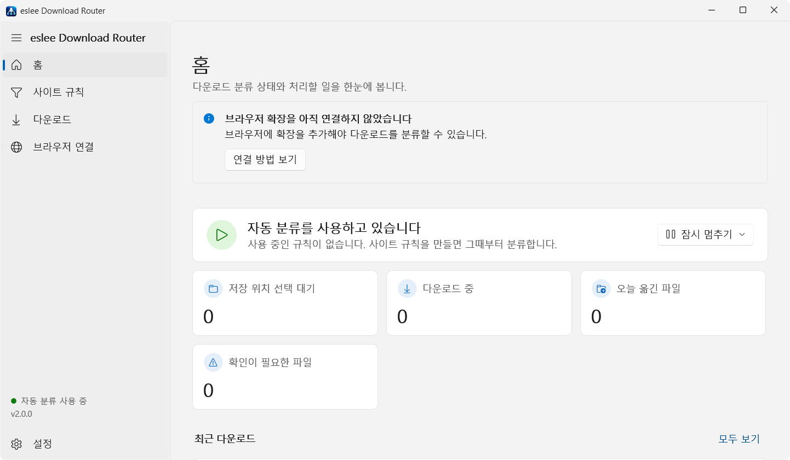

연결이 끝난 뒤 브라우저에서 아무 파일이나 하나 내려받으면, 브라우저 연결 화면 맨 위가 **연결됨 · 마지막 연결 (시각)** 으로 바뀝니다.

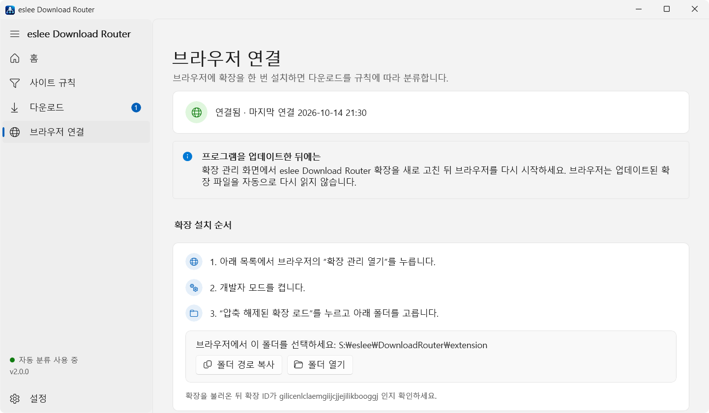

> 회사나 학교 PC에서는 보안 정책 때문에 개발자 모드나 확장 추가가 막혀 있을 수 있습니다.

## 3. 사이트 규칙 만들기

규칙은 "어떤 사이트에서 받은 파일을 어느 폴더로 보낼지"를 정합니다.

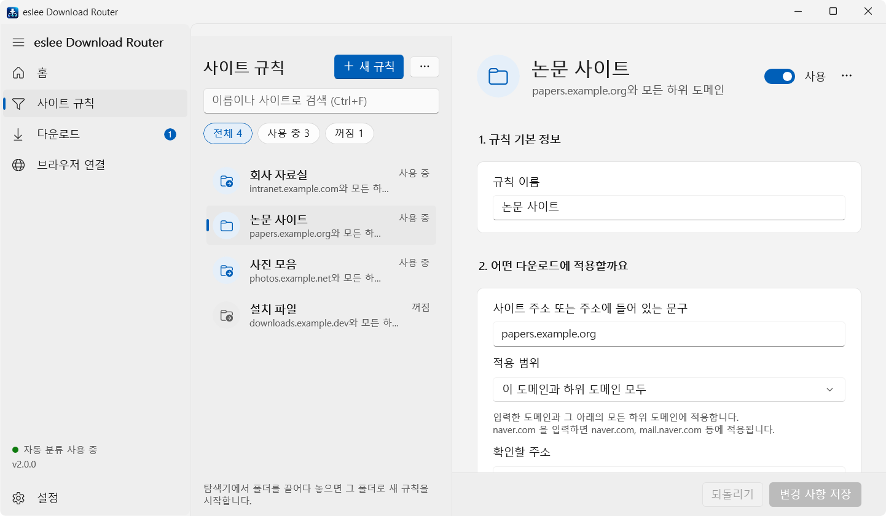

1. 왼쪽 메뉴에서 **사이트 규칙**을 열고 **새 규칙**을 누릅니다.
   파일 탐색기에서 폴더를 이 화면으로 끌어다 놓으면, 그 폴더로 저장하는 새 규칙이 바로 시작됩니다.
2. **1. 규칙 기본 정보** — 나중에 알아볼 이름을 적습니다(예: `논문 사이트`).
3. **2. 어떤 다운로드에 적용할까요** — 사이트 주소(예: `papers.example.org`)를 적고 **적용 범위**를 고릅니다.
   **확인할 주소**는 기본값인 **다운로드를 시작한 웹페이지**를 그대로 두면 대부분 맞습니다.
4. **3. 어떤 파일에 적용할까요** — 필요하면 파일 종류를 정합니다(아래 설명).
5. **4. 어디로 보낼까요** — **찾아보기…** 로 **기준 폴더**를 고르고 **저장 방식**을 정합니다.
6. **5. 규칙 요약**에서 내용이 맞는지 확인하고 아래쪽 **규칙 저장**을 누릅니다.

오른쪽 위 **사용** 스위치로 규칙을 잠깐 끌 수 있습니다. 규칙을 지워도 이미 옮긴 파일과 기록은 지워지지 않습니다.

### 저장 방식

| 원하는 동작 | 고를 항목 |
|---|---|
| 항상 같은 폴더로 보내기 | **정한 폴더로 자동 이동** |
| 받을 때마다 기준 폴더 안에서 하위 폴더 고르기 | **다운로드마다 하위 폴더 선택** |

- 같은 이름의 파일이 이미 있으면 **덮어쓰지 않고** `파일 (1).pdf`처럼 새 이름으로 저장합니다.
- 다른 드라이브로 옮길 때는 복사한 파일이 온전한지 확인한 뒤에 원본을 정리합니다. 확인에 실패하면 원본을 그대로 둡니다.

### 파일 종류 조건

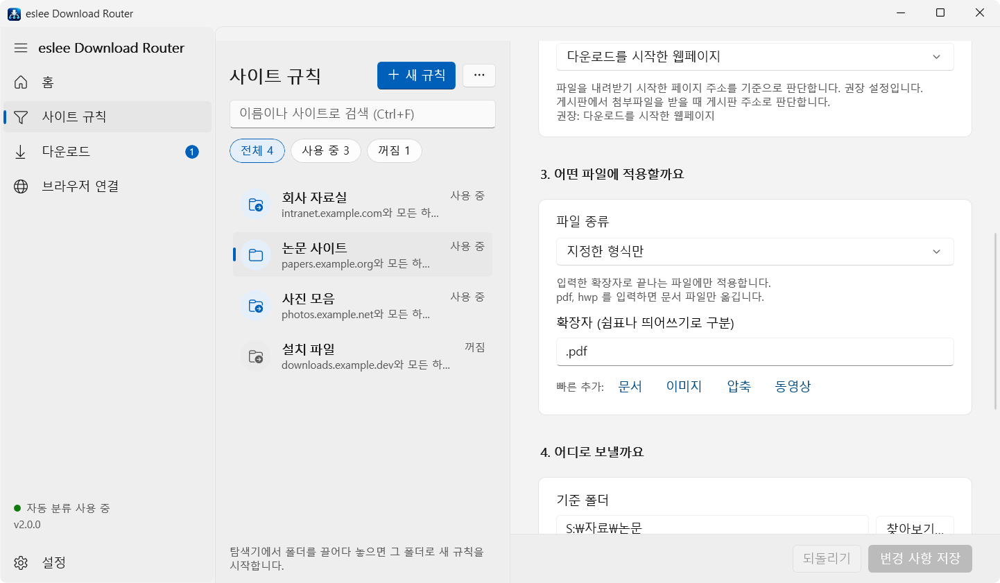

**파일 종류**에서 다음 중 하나를 고릅니다.

- **모든 파일** — 확장자와 관계없이 적용합니다(기본).
- **지정한 형식만** — 예를 들어 `.pdf`만 이 규칙으로 옮깁니다.
- **지정한 형식 제외** — 예를 들어 `.zip`은 옮기지 않습니다.

확장자는 쉼표나 띄어쓰기로 구분해 적고, **빠른 추가**의 **문서·이미지·압축·동영상**으로 한 번에 넣을 수도 있습니다.

### 규칙 백업과 옮기기

**새 규칙** 옆 **⋯** 메뉴의 **규칙 내보내기…** 로 규칙을 JSON 파일로 저장하고, 다른 PC에서 **규칙 가져오기…** 로 불러옵니다.

- 가져온 규칙은 **꺼진 상태**로 추가됩니다. 내용을 확인한 뒤 직접 켜세요.
- 이미 있는 규칙은 건너뛰고, 네트워크 경로(`\\서버\...`) 규칙은 가져오지 않습니다.

## 4. 저장 위치 고르기

저장 방식이 **다운로드마다 하위 폴더 선택**이면, 다운로드가 시작될 때 아래 창이 열립니다.

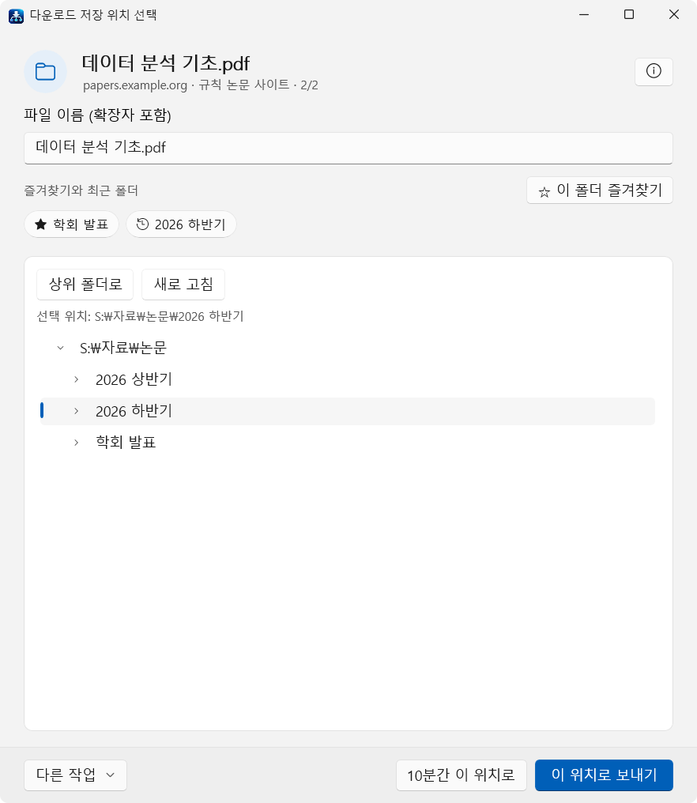

1. 필요하면 맨 위 **파일 이름 (확장자 포함)** 을 고칩니다. 그대로 두면 원래 이름으로 저장합니다.
2. 폴더 목록에서 저장할 폴더를 고릅니다. 규칙의 기준 폴더와 그 아래 폴더만 고를 수 있습니다.
   - **상위 폴더로**로 위 단계로 올라가고, 방금 만든 폴더가 안 보이면 **새로 고침**을 누릅니다.
   - 자주 쓰는 폴더는 **☆ 이 폴더 즐겨찾기**를 누르면 **즐겨찾기와 최근 폴더**에 ★로 남습니다. 최근에 고른 폴더도 여기 표시되어 한 번에 고를 수 있습니다.
3. **이 위치로 보내기**를 누르면 다운로드가 끝난 뒤 그 폴더로 옮깁니다.

다른 버튼은 이렇게 동작합니다.

| 버튼 | 결과 |
|---|---|
| **10분간 이 위치로** | 이 파일과 앞으로 10분 동안 같은 규칙으로 받는 파일을 모두 이 폴더에 저장합니다. 홈 화면에서 **취소**할 수 있습니다 |
| **다른 작업 > 대기 목록에 남기기** | 지금 정하지 않고 다운로드 화면의 **처리 대기**에 남깁니다 |
| **다른 작업 > 이번 파일은 옮기지 않기** | 이 파일은 옮기지 않습니다. 브라우저가 받은 자리에 그대로 남습니다 |
| **다른 작업 > 닫고 대기 목록에 남기기** | 창을 닫고 대기 목록에 남깁니다. 오른쪽 위 **X**도 같습니다 |

> 자동으로 뜨는 선택 창은 **파일당 한 번만** 표시됩니다. 대기 목록에 남긴 파일은 다운로드 화면에서 처리하세요.

## 5. 다운로드 기록

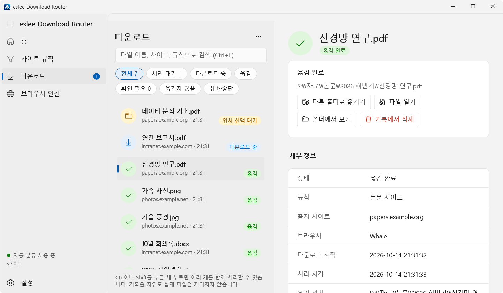

**다운로드** 화면에는 사이트 규칙에 맞은 다운로드만 기록됩니다. 왼쪽 메뉴의 숫자는 저장 위치를 기다리는 파일 수입니다.

- 위쪽 버튼으로 **전체 / 처리 대기 / 다운로드 중 / 옮김 / 확인 필요 / 옮기지 않음 / 취소·중단**을 골라 봅니다. 검색 상자(`Ctrl+F`)로 파일 이름, 사이트, 규칙을 찾을 수 있습니다.
- 파일을 고르면 오른쪽에서 다음을 할 수 있습니다.
  - **파일 열기**, **폴더에서 보기**
  - **다른 폴더로 옮기기** — 이미 옮긴 파일의 위치를 바꿉니다.
  - **저장 위치 선택** — 처리 대기 중인 파일의 폴더를 정합니다.
  - **다시 시도** — 옮기지 못한 파일(확인 필요)을 다시 옮깁니다.
  - **기록에서 삭제**
- `Ctrl`이나 `Shift`를 누른 채 여러 개를 고르면 한꺼번에 처리할 수 있습니다. 같은 규칙의 대기 파일이면 같은 폴더를 한 번에 정할 수 있습니다.

> **기록을 지워도 실제 파일은 지워지지 않습니다.** 프로그램의 기록만 지웁니다.

## 6. 자동 분류 잠시 멈추기

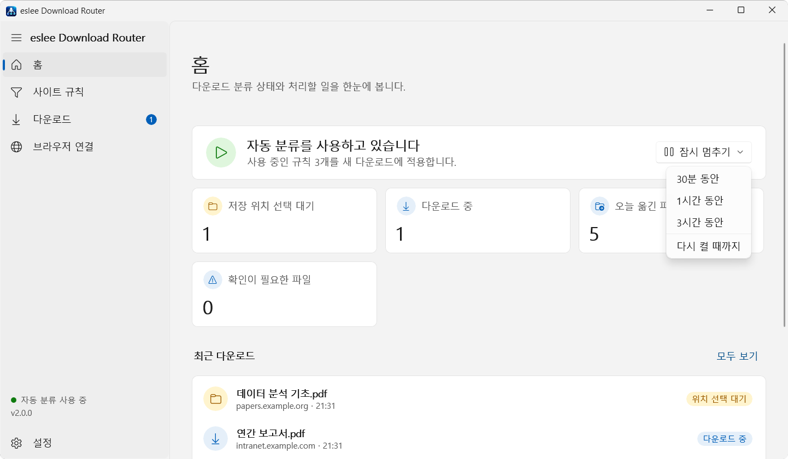

잠깐 규칙 없이 내려받고 싶을 때는 홈 화면의 **잠시 멈추기**를 누르고 **30분 동안 / 1시간 동안 / 3시간 동안 / 다시 켤 때까지** 중 하나를 고릅니다.

- 멈춘 동안 받은 파일은 옮기지 않고 브라우저가 평소처럼 저장합니다.
- 정한 시간이 지나면 자동으로 다시 켜집니다. 바로 켜려면 **다시 켜기**를 누릅니다.
- 트레이 메뉴의 **자동 분류 1시간 멈추기**로도 멈출 수 있습니다.

## 화면 구성

| 메뉴 | 설명 |
|---|---|
| **홈** | 자동 분류 상태, 저장 위치 선택 대기·다운로드 중·오늘 옮긴 파일·확인이 필요한 파일 수, 최근 다운로드 |
| **사이트 규칙** | 규칙 목록과 편집. 기준 폴더가 없어진 규칙은 **확인 필요**로 표시됩니다 |
| **다운로드** | 규칙에 맞은 다운로드 기록과 처리 |
| **브라우저 연결** | 확장 연결 상태, 확장 설치 순서, 이 PC에 설치된 브라우저 |
| **설정** | 테마, 언어, 동작, 기록 정리, 문제 해결, 정보 |

왼쪽 아래에는 지금 자동 분류가 켜져 있는지(**자동 분류 사용 중**)와 버전이 표시됩니다.

## 설정

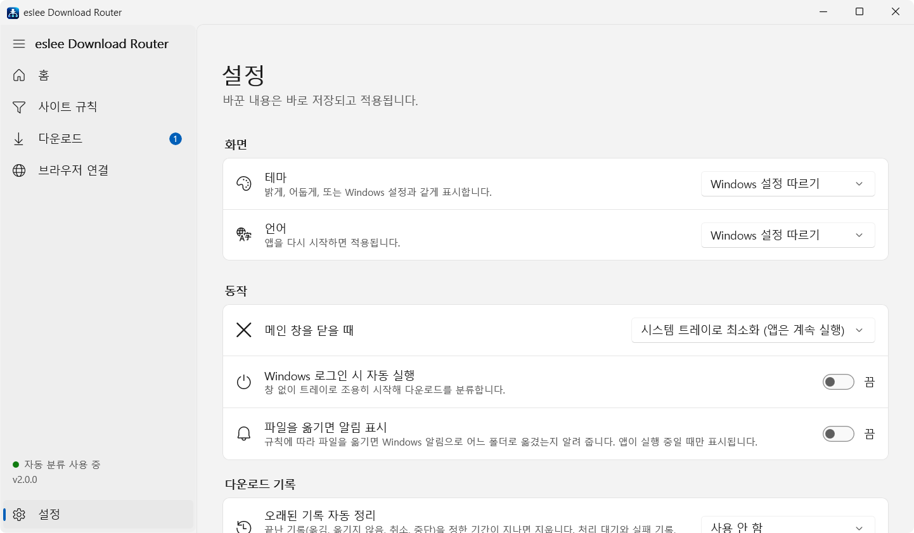

왼쪽 아래 **설정**을 누릅니다. 바꾼 내용은 저장 버튼 없이 바로 적용됩니다.

| 항목 | 설명 |
|---|---|
| **화면 > 테마** | Windows 설정 따르기 / 라이트 / 다크 |
| **화면 > 언어** | Windows 설정 따르기 / 한국어 / English (앱을 다시 시작하면 적용) |
| **동작 > 메인 창을 닫을 때** | 시스템 트레이로 최소화(앱은 계속 실행) 또는 앱 화면 완전히 종료 |
| **동작 > Windows 로그인 시 자동 실행** | 로그인할 때 창 없이 트레이에서 시작해 다운로드를 정리합니다 |
| **동작 > 파일을 옮기면 알림 표시** | 파일을 옮길 때마다 어느 폴더로 옮겼는지 Windows 알림으로 알려 줍니다(기본 꺼짐) |
| **다운로드 기록 > 오래된 기록 자동 정리** | 사용 안 함 / 7일·30일·90일·180일·1년 지난 기록. 처리 대기와 실패 기록, 실제 파일은 지우지 않습니다 |
| **문제 해결** | Agent 연결 확인, 데이터 폴더 열기, 진단 정보 |
| **정보** | 버전, 업데이트 확인, 개인정보, 지원 브라우저 |

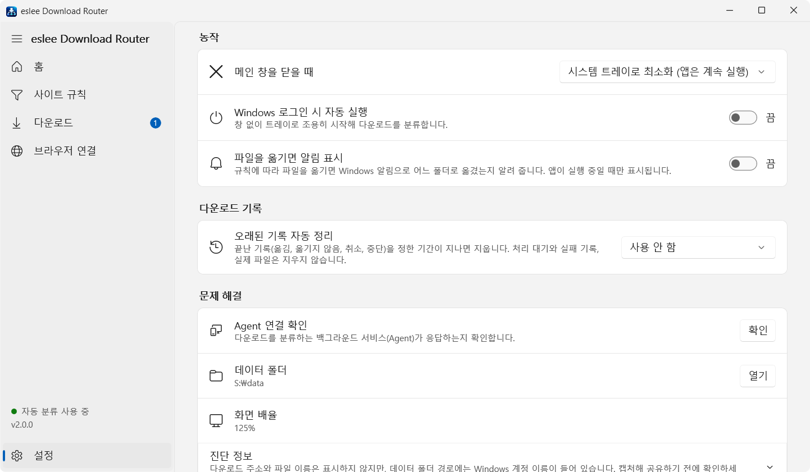

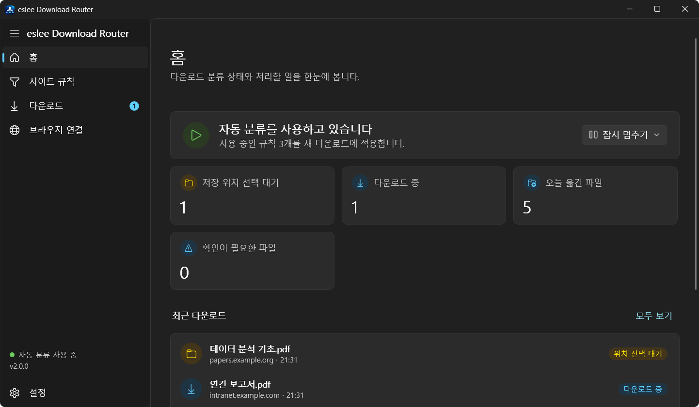

다크 테마를 적용한 화면입니다.

## 시스템 트레이

- 창의 **X**를 누르면 프로그램이 종료되지 않고 작업 표시줄 오른쪽 아이콘 영역(트레이)으로 숨겨집니다. 숨어 있는 동안에도 다운로드를 정리합니다.
- 트레이 아이콘을 **두 번 클릭**하면 창이 다시 열립니다. 한 번 클릭으로는 열리지 않습니다.
- 트레이 아이콘을 **우클릭**하면 **eslee Download Router 열기**, **저장 위치 선택 대기 열기**, **설정**, **자동 분류 1시간 멈추기**(멈춘 동안에는 **자동 분류 다시 켜기**), **종료** 메뉴를 쓸 수 있습니다.
- 완전히 끄려면 트레이 메뉴의 **종료**를 누릅니다. 꺼져 있는 동안 받은 파일은 정리되지 않습니다.
- eslee Tray Folder를 사용 중이면 별도의 트레이 아이콘 대신 Tray Folder 메뉴 안에 표시됩니다.

## 문제 해결

**새로 받은 파일이 정리되지 않습니다.**
1. 홈 화면 맨 위에 확장 관련 안내가 있는지 확인합니다.
2. 왼쪽 아래가 **자동 분류 사용 중**인지 확인합니다. 멈춰 있으면 홈에서 **다시 켜기**를 누릅니다.
3. **사이트 규칙**에서 그 규칙이 켜져 있는지, 사이트 주소와 파일 종류 조건이 맞는지 확인합니다.
4. **설정 > 문제 해결 > Agent 연결 확인**을 눌러 봅니다.

규칙에 맞지 않는 다운로드는 원래 자리에 저장되며, 다운로드 기록에도 남지 않는 것이 정상입니다.

**프로그램을 업데이트한 뒤 다운로드가 기록되지 않습니다.**
브라우저는 바뀐 확장 파일을 저절로 다시 읽지 않습니다. 확장 관리 화면에서 **eslee Download Router** 확장의 **새로 고침(↻)** 을 누른 뒤 브라우저를 완전히 껐다가 다시 켜세요. 이 경우에도 브라우저의 다운로드 자체는 정상으로 동작합니다.

**규칙에 "확인 필요"가 표시됩니다.**
기준 폴더가 없어졌거나 외장 디스크가 연결되어 있지 않은 경우입니다. 폴더를 다시 만들거나 디스크를 연결하고, 다른 폴더를 쓰려면 규칙에서 **찾아보기…** 로 바꿉니다.

**파일을 옮기지 못했다고 나옵니다(확인 필요).**
기준 폴더가 있는지, 다른 프로그램이 그 파일을 열어 두고 있지 않은지 확인한 뒤 다운로드 화면에서 **다시 시도**를 누르세요. 원래 파일은 브라우저가 저장한 자리에 그대로 있습니다.

**저장 위치 선택 창이 뜨지 않습니다.**
규칙의 저장 방식이 **다운로드마다 하위 폴더 선택**인지 확인합니다. 한 번 창을 닫았거나 **대기 목록에 남기기**를 누른 파일은 다시 뜨지 않으므로 **다운로드 > 처리 대기**에서 정하세요.

**X를 눌렀더니 프로그램이 사라졌습니다.**
트레이로 숨겨진 상태입니다. 트레이 아이콘을 두 번 클릭하세요. X를 눌렀을 때 창을 완전히 닫으려면 **설정 > 동작 > 메인 창을 닫을 때**를 바꿉니다.

**확장이 연결되지 않습니다.**
확장 ID가 `gilicenlclaemgiijcjjejilikbooggj`인지, 개발자 모드가 켜져 있는지 확인하고 브라우저를 완전히 다시 시작하세요. 브라우저별 자세한 방법은 [수동 확장 설치 안내](docs/MANUAL_EXTENSION_INSTALL.md)에 있습니다.

해결되지 않으면 [GitHub Issues](https://github.com/esleeeeee/eslee-download-router/issues)에 증상과 재현 순서를 남겨 주세요. 로그나 진단 정보를 첨부할 때는 파일 이름과 경로 등 개인적인 내용을 지워 주세요.

## 업데이트와 제거

- **업데이트**: 새 설치 파일을 실행하면 됩니다. 규칙, 다운로드 기록, 설정은 그대로 유지됩니다. 설치한 뒤에는 위 문제 해결 안내대로 **확장을 한 번 새로 고치세요**.
- 새 버전이 있는지는 **설정 > 정보 > 업데이트**에서 확인합니다(하루 한 번 자동 확인). 자동으로 설치하지는 않습니다.
- **제거**: Windows 설정의 앱 목록에서 제거합니다. 자동 실행, 브라우저 연결 등록, 알림 등록도 함께 지웁니다.
- 제거해도 규칙과 기록(`%LOCALAPPDATA%\eslee\DownloadRouter`)은 남아 있어, 다시 설치하면 이어서 사용할 수 있습니다. 완전히 지우려면 이 폴더를 직접 삭제하세요. 브라우저의 확장은 확장 관리 화면에서 직접 삭제합니다.

## 개인정보

- 계정 가입, 광고, 사용 통계 수집이 없습니다.
- 브라우저 확장과 프로그램은 **내 PC 안에서만** 통신합니다. 브라우저의 전체 방문 기록은 수집하지 않고 다운로드 정보만 씁니다.
- 인터넷 연결은 새 버전 확인에만 사용합니다. GitHub의 공개 배포 정보를 읽기만 할 뿐 PC의 정보는 전송하지 않습니다.
- 데이터는 모두 `%LOCALAPPDATA%\eslee\DownloadRouter`에 저장됩니다.
  - 규칙, 다운로드 기록(파일 이름, 저장 경로, 출처 주소). 출처 주소의 계정 정보, `?` 뒤 검색어, `#` 뒷부분은 저장하지 않습니다.
  - 설정(`config.local.json`)과 로그. 로그에는 파일 이름이 들어갈 수 있고, 예기치 않은 오류가 났을 때 남는 `app-unhandled.log`에는 전체 경로가 남을 수 있습니다.

자세한 보안 설계는 [SECURITY.md](SECURITY.md)를 참고하세요.

## 제한 사항

- Windows 11(64비트)과 Chromium 계열 브라우저용입니다. Firefox, Safari, 모바일은 지원하지 않습니다.
- Brave, Vivaldi, Opera는 같은 방식으로 동작하도록 만들었지만 실제 다운로드로는 아직 검증하지 않았습니다.
- 확장을 브라우저 스토어가 아니라 개발자 모드로 불러와야 합니다.
- 프로그램이 실행 중일 때만 다운로드를 정리합니다.
- 저장 위치 선택 창에서는 새 폴더를 만들 수 없습니다. 탐색기에서 만든 뒤 **새로 고침**을 누르세요.
- 설치 파일에 코드 서명이 없어 처음 실행할 때 SmartScreen 경고가 표시될 수 있습니다.
- 자세한 내용은 [브라우저 호환성](docs/BROWSER_COMPATIBILITY.md)과 [릴리스 노트](.github/release-notes/v2.0.0.md)를 참고하세요.

## 작동 원리

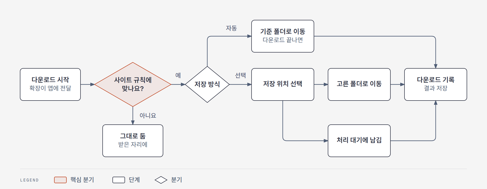

1. 브라우저 확장이 다운로드의 시작과 끝을 프로그램에 알립니다(Native Messaging).
2. 백그라운드 서비스(Agent)가 사이트 규칙과 비교해 옮길지, 저장 위치를 물을지 정합니다.
3. 다운로드가 끝나면 파일을 안전하게 옮기고 결과를 기록합니다. 어느 단계든 실패하면 파일을 원래 자리에 둡니다.

자세한 내부 구조는 [ARCHITECTURE.md](ARCHITECTURE.md)를 참고하세요.

## 개발자용 문서

C# / .NET 10, WinUI 3, SQLite, TypeScript 기반 Chromium 확장, Inno Setup으로 만들었습니다.

```powershell
git clone https://github.com/esleeeeee/eslee-download-router.git
Set-Location eslee-download-router
powershell -NoProfile -ExecutionPolicy Bypass -File .\scripts\bootstrap.ps1
powershell -NoProfile -ExecutionPolicy Bypass -File .\scripts\build.ps1
powershell -NoProfile -ExecutionPolicy Bypass -File .\scripts\test.ps1
```

- [DEVELOPMENT.md](DEVELOPMENT.md) — 개발 환경, 빌드, 설치 파일 생성, 확장 버전 정책
- [ARCHITECTURE.md](ARCHITECTURE.md) — 구성 요소, 상태 모델, 신뢰 경계
- [TESTING.md](TESTING.md) — 자동 테스트와 수동 검증 시나리오
- [SECURITY.md](SECURITY.md) — 보안 설계와 취약점 제보
- [docs/MANUAL_EXTENSION_INSTALL.md](docs/MANUAL_EXTENSION_INSTALL.md) — 브라우저별 확장 설치와 개발용 등록
- [docs/BROWSER_COMPATIBILITY.md](docs/BROWSER_COMPATIBILITY.md) — 브라우저별 검증 범위
- [CHANGELOG](CHANGELOG.md) — 버전별 변경 이력

이 프로젝트는 전 과정을 AI 코딩 에이전트와의 바이브코딩으로 개발했습니다. 화면 사진은 예시 사이트와 예시 폴더로 촬영했습니다.

## 라이선스

[MIT 라이선스](LICENSE)로 배포합니다. 누구나 자유롭게 사용·수정·배포할 수 있으며, 배포할 때는 저작권 표시와 라이선스 문구를 함께 포함해야 합니다. 프로그램은 어떠한 보증도 없이 있는 그대로 제공됩니다.
